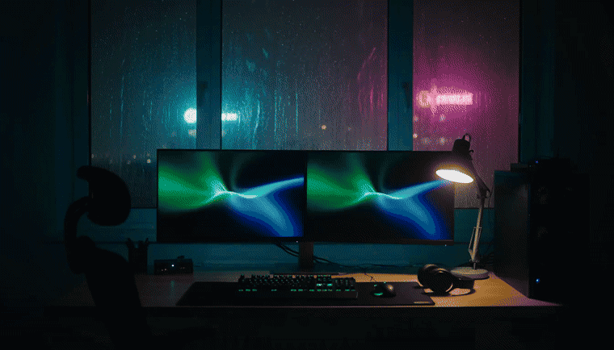
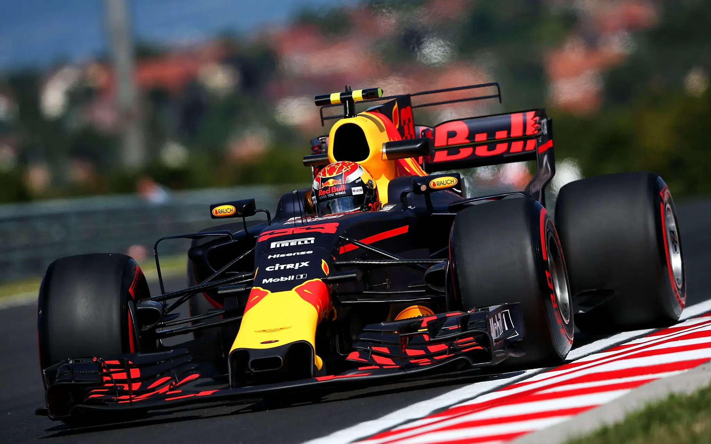

# Hi 👋 I’m Atharv

**I build things that think, learn, and do useful work.**

[GitHub](https://github.com/atharv1909) · [LinkedIn](https://www.linkedin.com/in/atharv-deshmukh09) · [LeetCode](https://leetcode.com/u/Atharv_009/)

---

## Currently on my desk

- Multi-agent systems that can use tools and make decisions
- Machine learning experiments for prediction and uncertainty
- Research software that turns messy ideas into working prototypes
- Small products where the interface matters as much as the model

I’m interested in the space between **research and shipping** — understanding how something works, then making it reliable enough for someone else to use.

## Recent builds

### [GravityDesk](https://github.com/atharv1909/GravityDesk)
A multi-agent autonomous system built around coordination, tools, and practical execution.

### [intelibot-scribe](https://github.com/atharv1909/intelibot-scribe)
An AI research assistant with plagiarism detection, document understanding, and PDF style learning.

### [QUANTis](https://github.com/atharv1909/QUANTis)
A Mixture-of-Experts approach to Indian stock-return prediction with conformal abstention.

### [Trinetra-AI](https://github.com/atharv1909/Trinetra-AI)
An applied AI project focused on turning automation ideas into a usable system.

### [spacecraft_autonomy](https://github.com/atharv1909/spacecraft_autonomy)
Experiments around decision-making and autonomy for spacecraft-oriented systems.

### [wattwise](https://github.com/atharv1909/wattwise)
A product build exploring clearer, smarter ways to understand energy usage.

[See everything I’ve been working on →](https://github.com/atharv1909?tab=repositories)

## Tools I reach for

  

## A few things I’m learning

- Designing agents that are useful without becoming unpredictable
- Making model outputs measurable instead of merely impressive
- Building software that survives beyond the first demo
- Getting better at algorithms through problem solving

## GitHub

  
  

  

---

  

